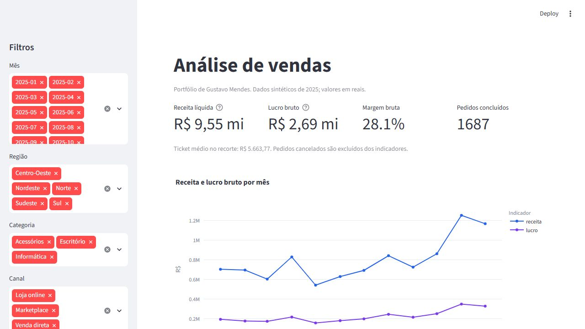

# Dashboard de vendas

Projeto de portfólio de [Gustavo Mendes](https://github.com/cyber-Gusta), com dashboard interativo em Python, análise em SQL, planilha Excel e materiais para reproduzir o painel no Power BI.



## Pergunta de negócio

Quais categorias, regiões e canais concentram receita e lucro bruto? Como esses indicadores variam ao longo dos meses?

## Leitura da base demonstrativa

A base contém 3,611 itens em 1.800 pedidos. A receita dos itens concluídos soma R$ 9,554,787.00, com margem bruta de 28.1%. Informática é a categoria de maior receita, com 67.8% do total. Esses valores descrevem somente a simulação.

## Executar o dashboard

Requer Python 3.11 ou superior. Abra o terminal nesta pasta:

```bash
python -m venv .venv
# Windows: .venv\Scripts\activate
# macOS/Linux: source .venv/bin/activate
python -m pip install -r requirements.txt
python -m streamlit run app.py
```

O painel oferece filtros, gráficos, indicadores e exportação do recorte em CSV.

## Arquivos e tecnologias

| Arquivo | Uso |
| --- | --- |
| `app.py` e `analytics.py` | Dashboard Streamlit, gráficos Plotly e regras de cálculo |
| `vendas.csv` | Base sintética em CSV UTF-8, vírgula como separador |
| `analise-vendas.xlsx` | Análise Excel com fórmulas e gráfico editável |
| `schema.sql` e `build_database.py` | Estrutura e carga no SQLite |
| `analysis.sql` | Consultas de indicadores e agrupamentos |
| `import.pq` | Importação e tipos no Power Query |
| `measures.dax` e `theme.json` | Medidas e tema para Power BI |
| `test_analytics.py` | Reconciliação SQL/Python e comportamento dos filtros |
| `DATA_DICTIONARY.md` | Grão, unidades, campos e origem |

## SQL

```bash
python build_database.py
```

Abra o banco gerado em um cliente SQLite e execute `analysis.sql`. A carga recria somente o arquivo de banco demonstrativo nesta pasta. O banco não é versionado.

## Excel

Abra `analise-vendas.xlsx`. A aba **Resumo** calcula os indicadores a partir da aba **Dados**. Os valores são fórmulas, e o gráfico está vinculado ao resumo mensal. Para acrescentar registros, estenda os intervalos das fórmulas e a tabela de dados; os limites atuais cobrem a base entregue.

## Reproduzir no Power BI

1. Crie um relatório vazio no Power BI Desktop.
2. Em **Transformar dados > Nova fonte > Consulta em branco > Editor avançado**, cole `import.pq` e ajuste `Caminho` para o CSV desta pasta.
3. Nomeie a consulta **Vendas** e aplique as alterações.
4. Crie cada medida de `measures.dax` separadamente. Formate receita, lucro e ticket como moeda; margem como percentual.
5. Importe `theme.json` pelo menu de temas e monte os visuais abaixo.
6. Salve como `.pbix` ou `.pbip` para continuar a edição no Power BI.

| Visual | Campos |
| --- | --- |
| Cartões | Receita Líquida, Lucro Bruto, Margem Bruta, Pedidos Concluídos |
| Linha mensal | `mes` no eixo, Receita Líquida e Lucro Bruto nos valores |
| Colunas por categoria | `categoria` e Receita Líquida |
| Barras por região | `regiao` e Receita Líquida |
| Segmentações | `mes`, `regiao`, `categoria`, `canal` |

O projeto entrega o CSV, Power Query, DAX e especificação visual. O arquivo nativo `.pbix` ainda precisa ser montado e validado no Power BI Desktop.

## Regras dos indicadores

- Receita líquida = soma de receita dos itens concluídos, já descontados os descontos comerciais.
- Lucro bruto = receita líquida menos custo da mercadoria; não inclui impostos, frete ou despesas operacionais.
- Margem bruta = lucro bruto / receita líquida, sem média simples de percentuais.
- Pedidos = contagem distinta de `pedido_id`; múltiplos itens não multiplicam pedidos.
- Ticket médio = receita no recorte / pedidos distintos no recorte. Um filtro de categoria pode selecionar somente parte de um pedido.
- Itens cancelados não entram nos indicadores. Valores monetários em centavos inteiros evitam arredondamentos divergentes entre ferramentas.
- Sem receita ou pedidos, margem e ticket ficam indisponíveis.

## Origem e limites

Todos os registros são **sintéticos**, gerados para demonstração com semente 42. Não representam clientes, resultados ou sistemas de uma empresa. As conclusões servem para explicar a análise; não são resultados profissionais do autor.

## Verificação

```bash
python -m pip install -r requirements-dev.txt
python -m pytest -q
```

Os testes verificam regras de negócio, igualdade dos totais entre SQL e Python, integridade da base e tratamento de filtros sem registros.

## Referências técnicas

- [Streamlit: gráficos Plotly](https://docs.streamlit.io/develop/api-reference/charts/st.plotly_chart)
- [Microsoft: medidas DAX](https://learn.microsoft.com/en-us/power-bi/transform-model/desktop-measures)
- [Microsoft: projetos Power BI no Git](https://learn.microsoft.com/en-us/power-bi/developer/projects/projects-overview)

Licença MIT. A base demonstrativa está incluída na mesma licença.
